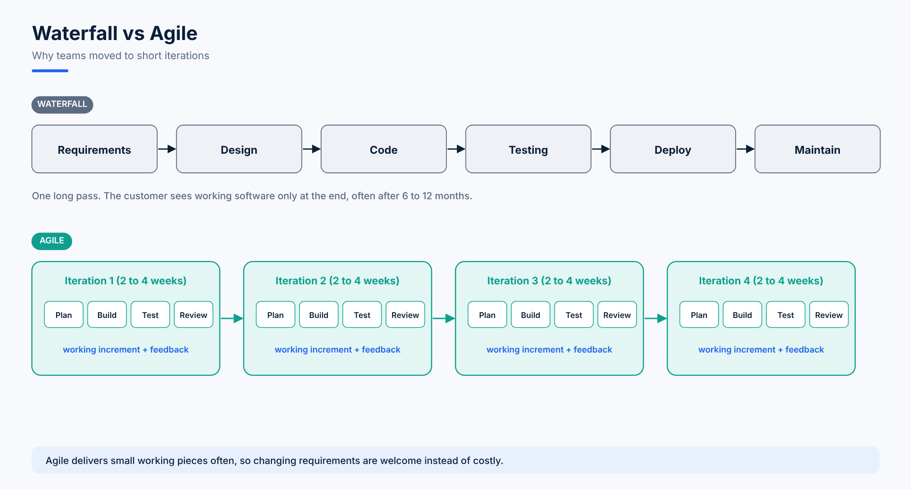

# 03. Understanding the Dashboard, Agile, Scrum and Kanban

## Finding Your Way Around

| Area | Where | What it's for |
|---|---|---|
| **Your work** | Top navigation | Issues assigned to you, recent items |
| **Projects** | Top navigation > Projects > View all projects | Every project you can access |
| **Boards** | Inside a project | The columns view of the project's issues |
| **Filters** | Top navigation > Filters | Saved searches (topics 04 and 05) |
| **Dashboards** | Top navigation > Dashboards | Gadgets and charts built from filters |
| **Settings** (gear icon) | Top right | Admin settings: users, billing, issues, workflows |

### Creating a Board with Sample Data

To practise without inventing issues:

1. Go to **Projects > View all projects > Create project**.
2. Choose the **Scrum** template and tick the option to include **sample data** if your site offers it.
3. Jira creates a board filled with example epics, stories, a sample sprint and sub-tasks.

## From Waterfall to Agile

In the **waterfall** model the project moves through design, code, testing, deployment and maintenance once, in order. When the customer asks for changes after seeing the result, the cycle starts again.

A customer asked *"how long will it take?"* hears *"6 months, maybe a year"*, but they want results as soon as possible. **Agile** solves this by delivering in small chunks.

### Agile Principles

1. **Iterative development:** build the product in small increments.
2. **Adaptive to changing requirements:** feedback after each increment changes the plan.
3. **Frequent delivery:** working software every few weeks, not once at the end.
4. **Close collaboration** between cross-functional team members: developers, QA, DevOps and the product side share responsibility equally.
5. **Frameworks:** Scrum and Kanban are the two most common ways to practise agile.

## Scrum

**Scrum** is a framework for project management that emphasises teamwork, accountability and iterative progress toward a well-defined goal. Its simple premise: *track the progress and tweak as necessary.*

### Work Items

| Item | Meaning | Example |
|---|---|---|
| **Epic** | A large body of work, broken into stories | *Course platform redesign* |
| **Story** | The smallest unit of user-visible work | *As a student, I can see my enrolled courses* |
| **Task** | A piece of technical work | *Set up the MySQL database* |
| **Bug** | Something broken | *Login page returns error 500* |
| **Sub-task** | A step inside a story or task, often split between teams | *Frontend changes*, *Backend API* |

The **backlog** is the list of issues describing everything the team plans to do on the project. Each item moves across the board: **To Do > In Progress > Done**.

### Scrum Roles

| Role | Responsibility |
|---|---|
| **Product Owner** | Owns the backlog, decides priorities, removes business blockers |
| **Scrum Master** | Runs the Scrum events, protects the team, clears obstacles |
| **Development team** | Developers, QA testers and DevOps engineers who build the increment |

### Scrum Events

| Event | When | Purpose |
|---|---|---|
| **Sprint** | 2 to 4 weeks | A fixed time box to finish the selected stories |
| **Sprint planning** | Start of the sprint | Choose stories and estimate them (story points or hours) |
| **Daily Scrum** (stand-up) | Every day, 15 minutes | What I did yesterday, what I'll do today, what's blocking me |
| **Sprint review** | End of the sprint | Demo what was done, decide what moves to the next sprint |
| **Retrospective** | After the review | What went well, what to improve |

### A Daily Scrum Example

> **Sara (Developer):** I finished the Node.js API, it's in *Done* and ready for testing.
> **Omar (QA):** I'll test it today with Selenium and Python.
> **Bilal (DevOps):** I'm blocked. The client hasn't approved port 8080 for the MySQL and WordPress Docker Compose stack.
> **Scrum Master:** Bilal, pause that and pair with Sara on the container setup. I'll chase the port approval.

## Kanban

**Kanban** is also an agile framework, focused on **visualising work**. A Kanban board helps teams visualise work, **limit work in progress (WIP)** and maximise flow. It helps both agile and DevOps teams bring order to their delivery.

The board has the same columns: **To Do > In Progress > Done**.

## Scrum vs Kanban

| | Scrum | Kanban |
|---|---|---|
| Time box | Fixed sprints of 2 to 4 weeks | No sprints, work flows continuously |
| Planning | Sprint planning before each sprint | Pull the next item when there's capacity |
| Roles | Product Owner, Scrum Master, team | No required roles |
| Change during the cycle | Avoided inside a sprint | Allowed at any time |
| Key metric | Velocity (points per sprint) | Cycle time, WIP limits |
| Best for | Product development with planned releases | Support, operations, incident queues |

> **Rule of thumb:** product teams building features usually choose Scrum. Support and DevOps teams handling a steady stream of requests usually choose Kanban.
