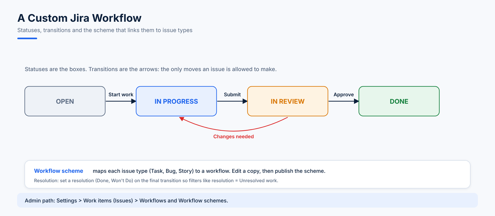

# 07. Jira Administration - Projects, Issue Types and Workflows

> Atlassian is renaming *issues* to **work items** and *issue types* to **work types** across Jira Cloud. Depending on your site you'll see either name; they mean the same thing.

This topic builds an **IT-Infra-project** (key `IIP`) for an operations team and gives it its own issue type and workflow. Use a **company-managed** project, because those use the shared admin schemes described here.

## Step 1: Create the Project

1. **Projects > Create project**.
2. Choose a template that fits operations work, for example **IT service management** or **Kanban**.
3. Choose **Company-managed**.
4. Name: `IT-Infra-project`, key: `IIP`.

## Step 2: Add an Issue Type

The operations team wants an issue type called **Issue** (used later by the memory-alert script in topic 15).

1. Gear icon > **Work items** > **Work types** (older sites: **Issues** > **Issue types**) > **Add work type** (or **Add issue type**).
2. Name it `Issue`, choose **Standard** (not sub-task) and save.
3. Go to **Work type schemes** (older sites: **Issue type schemes**), edit the scheme used by IIP and drag `Issue` into the scheme.

Default issue types:

| Type | Use |
|---|---|
| Epic | A big body of work |
| Story | A user-facing requirement |
| Task | A piece of work to do |
| Bug | Something broken |
| Sub-task | A step inside another issue |

## Step 3: Understand Workflows

A **workflow** is the set of **statuses** an issue can be in and the **transitions** that move it between them.

| Term | Meaning |
|---|---|
| **Status** | A stage, such as *Open*, *In Progress*, *Done* |
| **Transition** | A move between two statuses, such as *Start work*. Only defined moves are allowed |
| **Resolution** | A field (Done, Won't Do, Duplicate) set when work ends. Filters like `resolution = Unresolved` depend on it |
| **Workflow scheme** | Maps each issue type in a project to a workflow |

## Step 4: Create a Custom Workflow for Tasks

Jira generates a **Software Simplified Workflow** for each project. It's managed by Jira, so don't edit it directly.

1. Gear icon > **Work items** > **Workflows**.
2. Find the workflow you want to start from and choose **Copy**. The copy starts as **Inactive** because no project uses it yet.
3. Rename it, for example `TASK Workflow for Project PP`.
4. **Edit** the copy and use the **Diagram** view:
   - Add statuses: `OPEN`, `IN PROGRESS`, `DONE`.
   - Add transitions: `OPEN > IN PROGRESS`, then a `Closed` transition from `IN PROGRESS > DONE`.
   - On the transition into `DONE`, set the **resolution** to *Done*.
5. **Publish** the workflow.

## Step 5: Assign the Workflow to an Issue Type

1. Gear icon > **Work items** > **Workflow schemes**.
2. Edit the scheme used by the project (for example `PP: Software Simplified Workflow Scheme`).
3. **Add workflow > Add existing**, pick `TASK Workflow for Project PP`, and assign it to the **Task** issue type only.
4. Jira saves the change as a **draft**. Click **Publish**, and map existing issues to the new statuses when asked.

From now on, Tasks in that project follow the new workflow, while Stories and Bugs keep the default one.

> **Test first:** make workflow changes on a copy of the project, or on your development site, before touching a busy production project.
