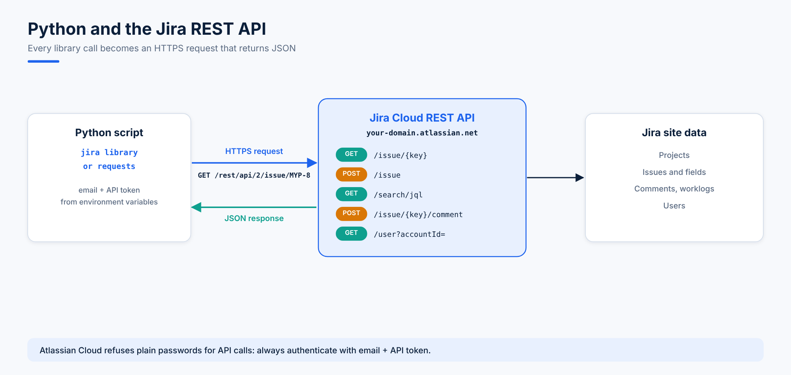

# 08. Jira REST API and API Tokens

Everything you can do in the Jira web interface is also available through the **Jira REST API**. Python, monitoring tools, CI pipelines and chatbots all talk to Jira this way.



## REST API Basics

| Idea | In Jira |
|---|---|
| **Base URL** | `https://your-domain.atlassian.net/rest/api/2/` (or `/rest/api/3/`) |
| **Resource** | Things you can read or change: `issue`, `project`, `user`, `search`, `comment` |
| **HTTP method** | `GET` reads, `POST` creates, `PUT` updates, `DELETE` removes |
| **Format** | Requests and responses are **JSON** |
| **Authentication** | Your Atlassian email plus an **API token** |

Documentation: https://developer.atlassian.com/cloud/jira/platform/rest/v3/intro/

### Version 2 vs Version 3

| | `/rest/api/2/` | `/rest/api/3/` |
|---|---|---|
| Rich text (description, comments) | Plain text or wiki markup | **Atlassian Document Format (ADF)**, a JSON structure |
| Used by the `jira` Python library | Yes, by default | Some newer endpoints |

Both versions work on Jira Cloud. Topic 13 sends an ADF description with `requests` to the v3 endpoint.

## Seeing an Issue as JSON

Open this URL in a browser where you're signed in to Jira:

```text
https://your-domain.atlassian.net/rest/api/latest/issue/MYP-8
```

You get the raw JSON for the issue. Trimmed to the important parts, it looks like this:

```json
{
  "id": "10025",
  "key": "MYP-8",
  "fields": {
    "summary": "Critical Bug",
    "description": "I am unable to login the portal",
    "issuetype": {"name": "Bug", "subtask": false},
    "project": {"key": "MYP", "name": "myproject"},
    "priority": {"name": "Highest"},
    "status": {"name": "In Progress", "statusCategory": {"name": "In Progress"}},
    "labels": ["KAN"],
    "assignee": {"accountId": "<account-id>", "displayName": "Ahmad Hassan", "timeZone": "Asia/Karachi"},
    "reporter": {"accountId": "<account-id>", "displayName": "Ahmad Hassan"},
    "created": "2025-02-08T07:37:00.860+0500",
    "timetracking": {"originalEstimate": "7w", "remainingEstimate": "6w 2d", "timeSpent": "3d"},
    "comment": {"total": 1, "comments": [{"id": "10000", "body": "i am working on it",
                "author": {"displayName": "Ahmad Hassan"}, "created": "2025-02-10T21:44:36.655+0500"}]},
    "worklog": {"total": 1, "worklogs": [{"timeSpent": "3d", "started": "2025-02-09T21:42:00.736+0500"}]}
  }
}
```

The Python `jira` library turns this JSON into objects, so `issue.fields.summary` returns `"Critical Bug"` and `issue.fields.status.name` returns `"In Progress"`.

Useful field paths:

| Python | JSON path | Example value |
|---|---|---|
| `issue.key` | `key` | `MYP-8` |
| `issue.fields.summary` | `fields.summary` | `Critical Bug` |
| `issue.fields.issuetype.name` | `fields.issuetype.name` | `Bug` |
| `issue.fields.project.key` | `fields.project.key` | `MYP` |
| `issue.fields.status.name` | `fields.status.name` | `In Progress` |
| `issue.fields.priority.name` | `fields.priority.name` | `Highest` |
| `issue.fields.reporter.displayName` | `fields.reporter.displayName` | `Ahmad Hassan` |
| `issue.fields.timetracking.originalEstimate` | `fields.timetracking.originalEstimate` | `7w` |
| `issue.fields.comment.comments` | `fields.comment.comments` | list of comments |

## Why Your Password Doesn't Work

Jira Cloud **rejects your account password** for API calls. Scripts that pass `basic_auth=(email, password)` fail with an authentication error. You need an **API token** instead.

## Creating an API Token

1. Open https://id.atlassian.com/manage-profile/security/api-tokens (or **Profile picture > Manage account > Security > Create and manage API tokens**).
2. Click **Create API token**.
3. Give it a **label** that says where it's used, for example `python-automation-laptop`.
4. Choose an **expiry date**. New tokens expire after at most one year.
5. Click **Create**, then **Copy** the token. Atlassian shows it **only once**.

### Keeping the Token Safe

An API token is as powerful as your password. Treat it the same way:

- **Never** paste it into a script, a notebook or a Git repository.
- Store it in **environment variables** and read it with `os.environ`:

```bash
# Linux and macOS (add these lines to ~/.bashrc to keep them)
export JIRA_SERVER="https://your-domain.atlassian.net"
export JIRA_EMAIL="you@example.com"
export JIRA_API_TOKEN="paste-your-token-here"
```

```powershell
# Windows PowerShell (current session)
$env:JIRA_SERVER = "https://your-domain.atlassian.net"
$env:JIRA_EMAIL = "you@example.com"
$env:JIRA_API_TOKEN = "paste-your-token-here"
```

In Google Colab, use the **Secrets** panel (key icon) and read values with `from google.colab import userdata`.

- If a token leaks, **revoke** it on the API tokens page right away and create a new one.
- Create a separate token per machine or script, so revoking one doesn't break the others.
