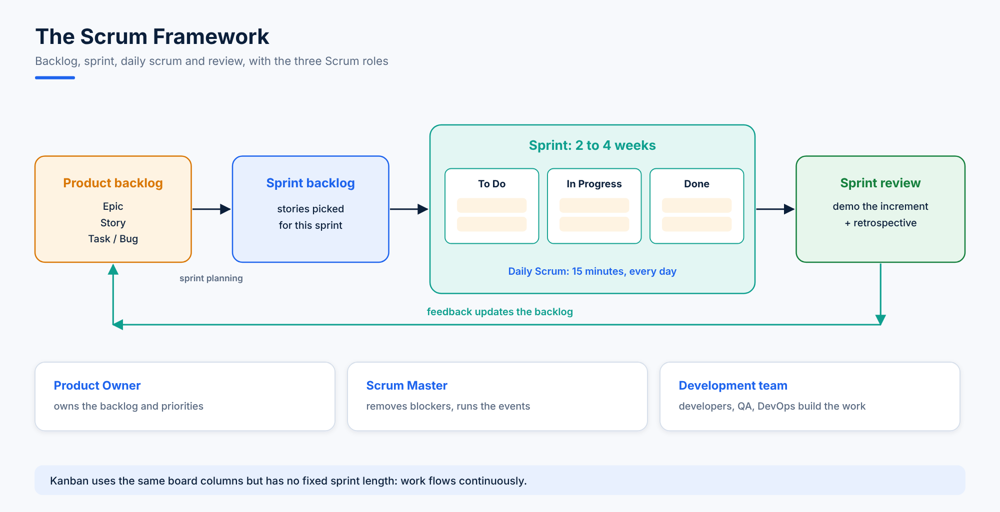

<div align="center">

# 📋 Python Jira for AI Product Management

**Run AI and software projects the way product teams do: 15 topics taking you from Agile, Scrum and Kanban in Jira through JQL, boards and workflow administration to automating Jira with Python, from reading comments and creating tickets to auto-reply emails and monitoring alerts that open tickets by themselves.**


</div>

---

## 🎯 About this course

Two skills in one place. The first half is the product management side of Jira: why agile beats waterfall, how Scrum and Kanban work, how to organise projects, boards and issues, how to search with JQL, and how admins manage users, issue types and workflows. The second half connects Jira to Python through its REST API, so scripts can read, search, create and update tickets on their own.

- **Notes (📄)** explain the concepts with step-by-step instructions for the Jira Cloud interface.
- **Notebooks (📓)** contain the Python code with the outputs recorded on a practice Jira Cloud site.



---

## 📚 Course contents

### 🧭 Jira Foundations

| # | Topic | Format |
|---|---|---|
| 01 | [Introduction to Jira and Issue Tracking](01.%20Introduction%20to%20Jira%20and%20Issue%20Tracking.md) | 📄 Notes |
| 02 | [Jira Installation and Cloud Setup](02.%20Jira%20Installation%20and%20Cloud%20Setup.md) | 📄 Notes |
| 03 | [Understanding the Dashboard, Agile, Scrum and Kanban](03.%20Understanding%20the%20Dashboard%2C%20Agile%2C%20Scrum%20and%20Kanban.md) | 📄 Notes |

### 🔎 Working in Jira

| # | Topic | Format |
|---|---|---|
| 04 | [Projects, Boards, Issues and Filters](04.%20Projects%2C%20Boards%2C%20Issues%20and%20Filters.md) | 📄 Notes |
| 05 | [Advanced Search with JQL](05.%20Advanced%20Search%20with%20JQL.md) | 📄 Notes |

### 🛠️ Jira Administration

| # | Topic | Format |
|---|---|---|
| 06 | [Jira Administration - Users and Sites](06.%20Jira%20Administration%20-%20Users%20and%20Sites.md) | 📄 Notes |
| 07 | [Jira Administration - Projects, Issue Types and Workflows](07.%20Jira%20Administration%20-%20Projects%2C%20Issue%20Types%20and%20Workflows.md) | 📄 Notes |

### 🔌 Jira and Python

| # | Topic | Format |
|---|---|---|
| 08 | [Jira REST API and API Tokens](08.%20Jira%20REST%20API%20and%20API%20Tokens.md) | 📄 Notes |
| 09 | [Connecting Python to Jira](09.%20Connecting%20Python%20to%20Jira.ipynb) | 📓 Notebook |
| 10 | [Reading and Filtering Comments](10.%20Reading%20and%20Filtering%20Comments.ipynb) | 📓 Notebook |
| 11 | [Searching Issues with JQL in Python](11.%20Searching%20Issues%20with%20JQL%20in%20Python.ipynb) | 📓 Notebook |
| 12 | [Creating Issues, Worklogs and Attachments](12.%20Creating%20Issues%2C%20Worklogs%20and%20Attachments.ipynb) | 📓 Notebook |
| 13 | [Calling the Jira REST API with requests](13.%20Calling%20the%20Jira%20REST%20API%20with%20requests.ipynb) | 📓 Notebook |

### 🚀 Automation Projects

| # | Topic | Format |
|---|---|---|
| 14 | [Project - Auto-Acknowledgement Emails for New Tickets](14.%20Project%20-%20Auto-Acknowledgement%20Emails%20for%20New%20Tickets.ipynb) | 📓 Notebook |
| 15 | [Project - Low Memory Alerts as Jira Tickets](15.%20Project%20-%20Low%20Memory%20Alerts%20as%20Jira%20Tickets.ipynb) | 📓 Notebook |

### 🧪 Data and project scripts

| Folder | Contents |
|---|---|
| [`data`](data) | `sample_jira_issues.csv` for bulk creation (topic 12) and `sample.txt` for attachments |
| [`projects/ticket_acknowledgement.py`](projects/ticket_acknowledgement.py) | Emails every reporter of a new unassigned ticket (topic 14) |
| [`projects/memory_alert.py`](projects/memory_alert.py) | Checks servers over SSH and opens a ticket on low memory (topic 15) |
| [`projects/bulk_create_from_csv.py`](projects/bulk_create_from_csv.py) | Creates one issue per CSV row, with a `--dry-run` mode (topic 12) |

---

## 🚀 How to use it

1. Create a free Jira Cloud site (topic 02) and a practice project with the key `MYP`.
2. Read topics 01 to 08 with your Jira site open and repeat each step in the interface.
3. Create an **API token** (topic 08) and set the environment variables the notebooks read:
   ```bash
   export JIRA_SERVER="https://your-domain.atlassian.net"
   export JIRA_EMAIL="you@example.com"
   export JIRA_API_TOKEN="paste-your-token-here"
   ```
4. Install the packages and open the notebooks in Jupyter or Google Colab:
   ```bash
   pip install -U jira requests paramiko
   ```
5. Run bulk-create and automation scripts against a practice project or a development site first.

> Never commit API tokens or passwords. Every notebook and script here reads them from environment variables.

---

## 👨‍🏫 About the author

**Ahmad Hassan** | AI/ML Engineer & Instructor with 5+ years of experience
1,500+ hours of live teaching, 100+ students mentored from medicine, business and engineering into data and DevOps roles.

[](https://ahmadhassan-aiops.github.io)
[](https://www.linkedin.com/in/ahmad-hassan-79a44b1a3)
[](https://github.com/ahmadhassan-aiops)

⭐ If these notes help you manage projects with Jira and Python, please star the repo. It helps other students find it!
